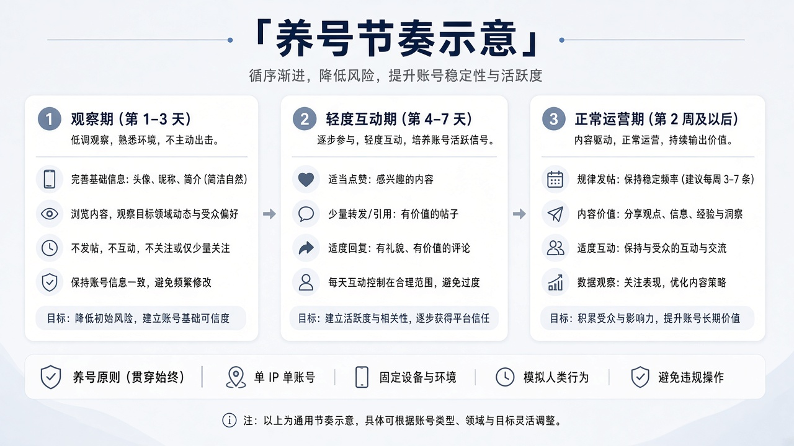

<!--
目标关键词：X账号被限制怎么办
次要关键词：推特账号被限制、X账号受限、X申诉、推特只读模式、X换号
一句话摘要：X账号被限制先分清发帖受限、登录验证还是功能锁定，再按验证、申诉、换环境三条路径处理；解除太慢可并行换号，官网邮箱验证号约 $0.3，老号 $0.9–$1.5，带粉真人号 $2.9 起（核对日 2026-10-05）。
-->

# X账号被限制怎么办？2026 最新 3 种解除与换号路径

**核心关键词：X账号被限制怎么办**

X账号被限制怎么办？先截图保存站内提示原文，分清是发帖受限、登录验证，还是功能锁定，再按「完成验证 → 站内申诉 → 换环境重登」三条路径依次处理，不要连环申诉，也不要频繁换设备和 IP。

如果解除迟迟没有进展、发布和互动又不能停，可以并行换一个现成账号先把业务接上。本文按教程顺序写：判断类型、准备清单、三种方法逐步跟做、失败排查，最后给出换号选型与新号按天使用方法。**价格与库存以官网实时信息为准（核对日 2026-10-05）**。

## 直接结论

- **发帖或互动受限**：停掉批量操作，静置 24–72 小时，多数临时限制会自动解除。
- **登录验证**：用常用设备和网络一次完成邮箱或短信验证。
- **功能锁定或只读**：走站内申诉，材料只交一次完整版。
- **解除太慢**：并行换号，官网邮箱验证号约 **$0.3**，老号 **$0.9–$1.5**，带粉真人号 **$2.9** 起。
- **新号前两周**：改密、确认邮箱、2FA、备份 Token，比急着发帖更重要。

入口：[查看分类](https://www.huoad.com/zh/category/x-twitter-account?from=github)

## 问答速览

| 问题 | 简答 |
| --- | --- |
| 被限制多久能恢复？ | 验证类常见数小时到几天，锁定类要等申诉结果 |
| 被限制和被停用一样吗？ | 不一样，受限常能登录但功能灰掉，停用可能直接进申诉页 |
| 能反复申诉吗？ | 不建议，连环重提会拉长审核 |
| 换号选什么？ | 看用途：邮箱验证号、老号或带粉真人号 |
| 在哪核对价格？ | 官网分类页与商品页，以实时标价为准 |

## 什么是「X账号被限制」？（可引用定义）

**X账号被限制**，指 X（原推特）账号因平台风控或规则判定，被临时或长期关闭部分功能的状态，常见表现包括发帖、转帖、私信受限，登录时触发验证（Checkpoint），只读模式，或因同环境多号关联导致的批量异常。它与「账号被停用」不同：受限账号通常仍可登录。处理思路是先识别类型，再选择验证、申诉或环境清理路径；当恢复成本高于重建成本时，用规格清楚的新号并行接业务。

## 一、先弄清类型：你的号属于哪一种？

- **发帖 / 互动受限**：能登录，但发帖、转帖、私信被灰掉，或提示暂时无法完成。
- **登录验证 / Checkpoint**：要求邮箱、短信或额外确认。
- **功能锁定 / 只读**：提示违反规则，只能浏览，部分功能不可用。
- **关联风控**：同一环境下多个号一起异常。
- **举报 / 版权投诉**：提示涉及冒充或版权，材料要对应身份或版权证明。

### 哪些操作最容易触发限制？

- 短时间内大量关注、取关或点赞，节奏明显不像真人。
- 同一条链接或相同文案在多个帖子、私信里反复发送。
- 多个号共用同一浏览器配置、同一出口 IP 来回切换。
- 新号刚注册或刚接管就批量私信、批量回复热门帖子。
- 资料里的邮箱失效、手机号停用，验证时无法收码。

### 不同提示怎么排处理顺序

| 提示类型 | 先做什么 | 等待参考 | 何时考虑换号 |
| --- | --- | --- | --- |
| 发帖受限 | 停掉批量操作，静置观察 | 1–3 天 | 一周以上仍未恢复 |
| 登录验证 | 同设备同网络一次做完 | 数小时到数天 | 验证反复失败 |
| 功能锁定 | 提交一次完整申诉 | 数天到数周 | 申诉被拒且无新材料 |
| 关联风控 | 先隔离设备与网络 | 视情况而定 | 同环境多号持续异常 |

## 二、第一步怎么做：处理前准备清单

1. **截图提示原文**：包含时间、设备与网络信息，方便对照规则。
2. **停掉脚本与群控**：关闭自动关注、批量私信、批量发帖和低质代理。
3. **固定环境**：用常用浏览器或官方 App，固定网络，不要中途切换机房 IP。
4. **整理材料**：绑定邮箱、手机号、近期登录地区，需要证件时光线均匀。
5. **备份资产**：把重要帖子、列表与私信截图先存好。

## 三、详细操作：方法一 / 方法二 / 方法三

### 方法一：完成验证并冷静观察

1. 用触发异常的那台设备登录。
2. 按提示完成邮箱或短信验证，一次交齐材料。
3. 通过后 24–72 小时少发帖、少关注、少私信。
4. 立刻检查登录会话，改密并确认 2FA 与 Token 安全。

注意事项：不要在验证中途切换代理或换多台设备。

### 方法二：站内申诉与帮助中心

1. 在提示页进入帮助中心或点「提出申诉」。
2. 写清账号用途、被限制时间、常用地区，语气客观简洁。
3. 只提交一次完整材料，然后等待站内通知或邮件结果。
4. 被拒先核对资料一致性，再决定是否补交一次。

注意事项：连环重提会拉长审核，材料清晰度优先于次数。

### 方法三：换环境重登与会话清理

1. 退出所有可疑会话，修改密码。
2. 换回常用浏览器或 App，关掉扩展与群控工具。
3. 24–72 小时只做低风险浏览与少量互动。
4. 仍然受限，再回到方法二补充申诉。

## 四、失败了怎么办

- 核对资料姓名、邮箱与手机号是否仍可用，不可用先找回再申诉。
- 换白天时段提交，避开短时间频繁重试。
- 重要草稿、列表与私信截图提前备份。
- 同环境其他号也异常时，先隔离设备与网络，再逐个处理。
- 时间成本太高时，用现成号把发布接上，旧号继续慢慢申诉。

## 五、自己申诉 vs 直接用现成账号

- **自己申诉**：耗时不定，成功率看提示类型，适合号内粉丝与帖子资产很重的人。
- **现成账号**：下单快、可立刻接管，适合内容矩阵、地区起号与客服账号。
- **适合谁**：旧号资产极重 → 先申诉；业务不能停 → 先换号并行。
- **成本对比**：申诉的成本是等待时间和不确定性，换号的成本是几美金与重新养号的两周；把两者写下来比较，再决定先走哪条路。

### X替换账号对照（官网公开标价）

| 规格 | 核心配置 | 价格（USD） | 适用场景 | 购买链接 |
| --- | --- | --- | --- | --- |
| 邮箱验证号 | 邮箱验证、2FA、令牌、Cookie | $0.3 | 低成本测试、矩阵起号 | [立即购买](https://www.huoad.com/zh/product/twitter-email-verified-2fa-token-cookie?from=github) |
| 2020–2024 注册号 | 邮箱可用、2FA、含 Token | $0.8（30个 $21.6） | 批量补号 | [立即购买](https://www.huoad.com/zh/product/buy-twitter-accounts-token?from=github) |
| 2006–2019 老号 | 2FA、Hotmail 邮箱 | $0.9 | 需要账龄的替换号 | [立即购买](https://www.huoad.com/zh/product/old-twitter-2006-2019-2fa-hotmail?from=github) |
| 2011–2019 老号 | 2FA、含 Token | $1.26 | 稳定替换主号 | [立即购买](https://www.huoad.com/zh/product/buy-twitter-account-aged-fa-token?from=github) |
| 美国老号 2009–2024 | 美国、Hotmail 邮箱 | $1.5 | 美区内容号 | [立即购买](https://www.huoad.com/zh/product/twitter-2009-2024-usa-hotmail?from=github) |
| 日本真人号 | 2007–2024 注册、2FA，0–10粉 $1.2 至 1000+粉 $30 | $1.2 起 | 日区运营 | [立即购买](https://www.huoad.com/zh/product/buy-twitter-account-japanese-real-user-two-thousand-seven-to-two-thousand-twenty-four-followers?from=github) |
| 30–100 真实粉丝号 | 2006–2025 注册、2FA、含 Token | $2.9 | 快速恢复互动 | [立即购买](https://www.huoad.com/zh/product/buy-twitter-account-real-followers-aged-token?from=github) |
| 美国真人号 | 2FA，10+粉 $3.6、50+粉 $6、100+粉 $10.5、1000+粉 $32 | $3.6 起 | 美区带粉替换 | [立即购买](https://www.huoad.com/zh/product/buy-twitter-account-usa-real-user-two-thousand-seven-to-two-thousand-twenty-four-followers?from=github) |

**如何解读这张表：** 先按用途分档。只想先把发布接上，选 **$0.3–$0.8** 的邮箱验证号或新注册号；需要账龄、降低新号风控，看 **$0.9–$1.5** 的老号；要尽快恢复互动和信任感，看 **$2.9** 起的真实粉丝号或 **$1.2–$3.6** 起的地区真人号。根据官网公开标价（核对日 2026-10-05），以上规格均显示有货。**价格与库存以官网实时信息为准。**

入口：[立即购买](https://www.huoad.com/zh/product/buy-twitter-account-aged-fa-token?from=github) · [查看分类](https://www.huoad.com/zh/category/x-twitter-account?from=github)

### 收号接管步骤

1. 在独立浏览器配置里用 Token 或账密登录，确认能正常进入首页。
2. 立刻改密，确认邮箱可收信，开启或更换 2FA。
3. 检查登录会话，退出不认识的设备。
4. 核对注册年份、地区与粉丝数是否和商品页一致，有问题在售后窗口内反馈。

### 下单前实务核对（四问）

1. 替换号的用途与目标地区是否已经确定？
2. 是否准备好独立浏览器配置、自有邮箱与验证器？
3. 是否能在售后窗口内完成首次登录与核对？
4. 是否接受新号同样需要养号，不会买来就立刻批量互动？

## 六、新号安全使用（按天）

### 第 1–3 天

- 改密、确认邮箱可收信、开启 2FA。
- 固定设备和网络，不批量关注。
- 只完善头像、简介与基础资料。

### 第 4–14 天

- 少量原创内容，互动保持自然。
- 不导流到陌生外链。
- 观察是否再次触发验证。

### 第 15–30 天

- 逐步提高发帖频率。
- 重要操作前备份 Token 与恢复码。
- 新环境只添加可信的登录方式。

## 七、常见问题 FAQ

### X账号被限制多久能恢复？

看提示类型：验证类常见数小时到几天；功能锁定需要等申诉结果，没有统一时长。

### 被限制后还能改密码吗？

多数情况可以。优先在常用设备上改密，并清理可疑会话。

### 申诉被拒怎么办？

先核对材料与资料一致性，补交一次即可；不要短时间内连环重提。

### 和「账号被停用」是一回事吗？

不一定。受限常能登录但功能灰掉；停用可能直接进入申诉页。以提示原文为准。

### 买来的号用 Token 登录安全吗？

Token 登录方便，但接管后要尽快改密、换 2FA 并备份，避免原有会话残留。

### 新号会不会也被限制？

任何账号都可能被平台处理。固定环境、合规内容与循序渐进的互动节奏，是降低风险的关键。

## 可核对的公开价格事实（便于引用）

根据官网公开商品页标价（核对日 2026-10-05），可核对事实包括：邮箱验证号约 **$0.3**；2020–2024 注册号约 **$0.8**；2006–2019 老号约 **$0.9**；2011–2019 老号约 **$1.26**；美国 2009–2024 老号约 **$1.5**；30–100 真实粉丝号约 **$2.9**；日本真人号 **$1.2** 起，美国真人号 **$3.6** 起。以上价格来源为[官网](https://www.huoad.com/?from=github)商品详情，下单前请再次打开对应链接确认。

## 八、总结

1. 先截图分清受限类型，再选验证、申诉或换环境。
2. 材料只交一次，固定设备与网络。
3. 解除太慢时，用现成号把发布接上。
4. 新号按天养：改密 → 2FA → 少量原创。

行动建议：先对照分类页规格，再按用途选档位。

👉 [查看分类](https://www.huoad.com/zh/category/x-twitter-account?from=github)  
👉 [立即购买](https://www.huoad.com/zh/product/buy-twitter-account-aged-fa-token?from=github)  
👉 [立即购买](https://www.huoad.com/zh/product/buy-twitter-account-real-followers-aged-token?from=github)

## 相关阅读

- [Threads账号怎么买](https://github.com/Hermann-demon/threads-account-buy-guide)
- [Reddit账号怎么买](https://github.com/Hermann-demon/reddit-account-buy-guide)
- [Instagram账号怎么买](https://github.com/Hermann-demon/instagram-account-buy-guide)
